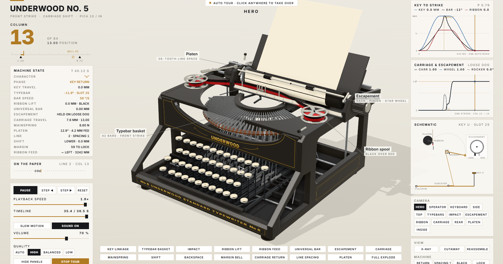

# Underwood No. 5 — Teardown Simulator

An interactive 3D teardown of an **Underwood No. 5** desktop typewriter, built entirely from code. Type on it with your
keyboard or by clicking its glass keys; open any mechanism with one button; watch one deterministic machine model drive
the keys, linkage, typebars, ribbon, escapement, carriage, bell, platen and paper, while every gauge, chart and the live
schematic read that same model.

**Live demo:** https://simsi2027.github.io/Typewriter-Teardown/

The tour can also be rendered to a deterministic 36.5 s 1080p60 video with sound (`npm run video`; see below).



Left alone, the page tours itself with a visible cursor. The status bar at the top says what is running (TOUR,
PAUSED, MANUAL, the idle countdown, TOUR COMPLETE) and holds the tour controls:

- **PAUSE TOUR** freezes the tour exactly where it is: camera, parts, cursor and timeline hold.
- **RESUME TOUR** continues from exactly where the tour was paused or interrupted, never from the start.
- **RESTART TOUR** is the only control that plays the tour from 0.
- Typing, clicking the machine's keys or a machine button, choosing a camera or a subsystem, dragging to orbit or
  scrolling to zoom hands you the machine (MANUAL) with the tour's position held. Your own strokes keep running.
  Sound, volume, quality and panel controls never interrupt the tour.
- After 25 s of quiet in MANUAL (a countdown shows from 8 s), the tour resumes from where you interrupted it. A
  finished tour holds its last frame, then loops. With reduced motion the tour never starts or resumes by itself.
- Browsers keep audio off until the first click or key press. The page says **ENABLE SOUND** until then. Your first
  gesture starts it, and your mute and volume settings are kept.

## What it does

- **Operates:** characters, space, backspace, shift (carriage shift: the subcarriage rises 5 mm), shift lock, margin
  release, carriage return with 1/2/3 line spacing, ribbon colour (black / red / stencil), margin bell 7 spaces
  before the line lock, line lock at the margin.
- **One model:** `src/model.js`. Every operator action is a normalized, deterministic stroke; the machine at any
  machine time τ is a pure function of the session and τ. Seeking, scrubbing, slow motion, the tour and the film all
  read it.
- **Console:** live column, readouts (key travel, typebar angle and speed, ribbon lift, universal bar, escapement phase,
  carriage travel, mainspring tension, platen angle, line, shift, margin, ribbon feed), the line on the paper, a
  key-to-strike chart, a carriage-and-escapement chart, and a side-section schematic with an escapement inset.
- **16 subsystem views** (isolate, cut away, explode along staged service paths — parts wait for the ones in front of
  them and leave their mounts before they slide; every pose and the way there is interference-tested on the real
  geometry), X-ray, cutaway, reassemble, 13 cameras, callouts with leaders that follow their parts.
- **Sound:** synthesised mechanical sounds, each scheduled from the action that moves the part.
- **Quality:** AUTO / HIGH / BALANCED / LOW (MSAA, GTAO, shadow-map size, pixel-ratio cap; AUTO steps down on slow GPUs).

## Controls

| Input | Action |
|---|---|
| Typing | characters (`1` types as a lower-case l, as on the period machine; unsupported characters are ignored) |
| Space / Backspace / Enter | space / backspace / carriage return |
| Shift (hold) / Caps Lock | shift / shift lock |
| Click a key, the space bar or the return lever | operate it |
| Drag / scroll | orbit / zoom |
| ← → | step: the tour while it is on screen (it pauses), your machine otherwise |
| Esc | hide or show the panels |
| PAUSE TOUR / RESUME TOUR / RESTART TOUR | pause, continue from the held position, play from the start |
| ENABLE SOUND / SOUND ON / SOUND OFF | start sound (first gesture), mute, unmute |

## Development

```
npm install
npx playwright install chromium   # for tests, stills and video
npm run dev        # debug build + local server on http://127.0.0.1:5173/Typewriter-Teardown/
npm run build      # production build into dist/
npm run preview    # serve dist/
npm test           # model and experience-state unit tests (node:test)
npm run test:e2e   # Playwright: controls, layouts (run.mjs) + the visitor-experience acceptance suite
npm run test:acceptance   # pause / resume / takeover / idle / restart / reduced motion / audio lifecycle only
npm run validate   # beat stills, contact sheet, views sheet, 0.2 s transition scrubs → validation/
npm run video      # deterministic 1920×1080 60 fps H.264 tour with sound → validation/video/
node scripts/collide.mjs   # interference report of every subsystem pose (headless, real geometry)
node scripts/audit.mjs --out validation/audit/after   # audit stills, sheets, transition scrubs
node scripts/sound-evidence.mjs     # records the mix handed to the audio device; loudness, peaks, waveforms
node scripts/teardown-check.mjs     # headed visitor check: loading, tour, status bar, 10 teardowns operated by hand
node scripts/look.mjs --out .cache/look.jpg   # fixed stills side by side for material / light / framing changes
```

Source layout, rules and the testing policy are in [CLAUDE.md](CLAUDE.md). Sources and the VERIFIED / ESTIMATED /
SIMPLIFIED classification of every dimension: [docs/SOURCES.md](docs/SOURCES.md),
[docs/ASSUMPTIONS.md](docs/ASSUMPTIONS.md). Validation results: [docs/VALIDATION.md](docs/VALIDATION.md). The 2026-11 audit: [docs/audit/LEDGER.md](docs/audit/LEDGER.md),
[docs/audit/FINAL_REPORT.md](docs/audit/FINAL_REPORT.md). The acceptance and repair pass that followed it (sound,
pause / resume / takeover, visual polish): [docs/audit/ACCEPTANCE.md](docs/audit/ACCEPTANCE.md).

## Deployment

GitHub Pages via GitHub Actions (`.github/workflows/pages.yml`) on every push to `main`: install, unit tests,
production build, upload, deploy. Asset paths are relative, so the site works under `/Typewriter-Teardown/`.

## Credits

Built in the manner of the `teardown` skill (V8 / Cessna / Strandbeest examples); its shader warm-up module and
capture approach derive from [whaleyxbt/claude-motion](https://github.com/whaleyxbt/claude-motion) (MIT). See
[THIRD_PARTY.md](THIRD_PARTY.md). MIT licence.
